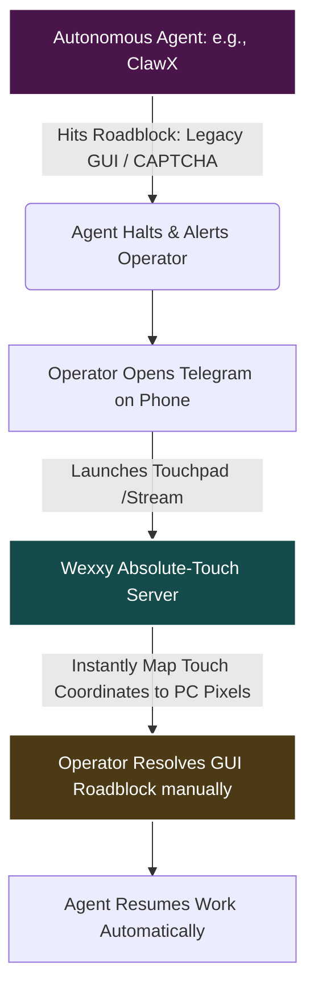

# Wexxy PC Bot: The Master Project Manual & System Guide

Welcome to the ultimate system manual for __Wexxy PC Bot__—a unified, production-grade, remote-control interface for Windows, operated entirely through Telegram and secure zero-config tunnels (`cloudflared`).

Wexxy is a bridge between the Human Operator, the Local OS environment, and autonomous AI agents (such as `ClawX` and `OpenClaw`). It provides a manual fallback layer, real-time absolute-coordinate streaming, a local voice-to-script assistant with self-correcting capabilities, and a glassmorphic system monitoring dashboard.

---

## Table of Contents

1. [Vision & Core Identity](#1-vision--core-identity)
2. [Product Requirements Document (PRD)](#2-product-requirements-document-prd)
3. [Technical Requirements Document (TRD)](#3-technical-requirements-document-trd)
4. [Backend Schema & Data Models](#4-backend-schema--data-models)
5. [UI/UX Design Specifications](#5-uiux-design-specifications)
6. [System Workflows & App Flow](#6-system-workflows--app-flow)
7. [The Voice & Autonomous AI Agent Pipeline](#7-the-voice--autonomous-ai-agent-pipeline)
8. [The Absolute Touch Remote Control & Streaming Engine](#8-the-absolute-touch-remote-control--streaming-engine)
9. [The Nebula OS Dashboard](#9-the-nebula-os-dashboard)
10. [Active Plugin Directory & Command Catalog](#10-active-plugin-directory--command-catalog)
11. [System Dependencies & Environment Requirements](#11-system-dependencies--environment-requirements)
12. [Implementation Roadmap & Progress](#12-implementation-roadmap--progress)
13. [Operations & Troubleshooting Playbook](#13-operations--troubleshooting-playbook)
14. [Issues Log: Fixed, Ongoing & Non-Fixed Problems](#14-issues-log-fixed-ongoing--non-fixed-problems)

---

## 1. Vision & Core Identity

### What is Wexxy PC Bot?

At its core, __Wexxy PC Bot__ is an omnipresent, highly modular remote-control interface for Windows. It integrates native system control tools, a fully local voice/multimodal AI pipeline (`faster-whisper` + `MiniCPM 2B Vision` + `Qwen 2.5 Coder 7B`), and remote desktop control (RustDesk).

### The "Agentic AI Unblocker" Vision

Wexxy is designed to be the __"Manual Heavy-Lifting Support System" for Agentic AI__.

As autonomous frameworks like __ClawX__ and __OpenClaw__ navigate codebases and operate systems, they inevitably encounter visual roadblocks (e.g., legacy graphical user interfaces, CAPTCHAs, fine-grained UI selections, or unhandled OS exceptions). Wexxy acts as the ultimate __hybrid bridge__ to resolve these problems:



* __The Unblocker:__ When a local autonomous agent gets stuck on a visual task or requires credentials input, the operator drops in via Wexxy’s __Absolute Touch Stream__ from their phone, completes the GUI interaction in seconds, and steps back.
* __The Fallback Actuator:__ While agents excel at scripting and APIs, humans excel at spatial reasoning. Wexxy supplies manual "hands and eyes" (virtual mouse, keyboard, and low-latency screen frame-grabbing) as a robust recovery layer.
* __Voice-to-Agent Command:__ Combining `faster-whisper` and local LLMs, Wexxy lets the operator dictate complex, unstructured voice notes while away from the keyboard, converting human intent into concrete scripts that execution agents run.

### Core Pillars

1. __Always-On Infrastructure:__ Configured to run in the background (via NSSM or Startup scripts) so it is always waiting to assist without cluttering the screen.
2. __Absolute Touch Precision:__ The streaming web interface maps tap coordinates directly to the PC’s native pixel resolution, making mobile interactions extremely fast.
3. __Strictly Local Ecosystem:__ No paid cloud subscriptions or proprietary external endpoints. It uses local libraries like `pycaw` and `mss` along with hardware-offloaded local LLMs (`llama.cpp` using the Nvidia RTX GPU) to remain private and sustainable.

---

## 2. Product Requirements Document (PRD)

### 2.1 Overview

Wexxy PC Bot gives users remote access and granular control over their Windows machine. It operates as an assistant, a remote system utility, and a media server, fully responsive on any Telegram client.

### 2.2 Target Audience

Developers, system administrators, power users, and AI operators who need lightweight, secure remote command execution and graphical feedback without the overhead of heavy RDP, VNC, or TeamViewer protocols.

### 2.3 Core Features

* __System Control:__ Launch installed applications, run raw PowerShell/CMD commands, and trigger power state controls (lock, shutdown, restart, sleep, log out).
* __File Management:__ Fast search via Everything CLI (`es.exe`) with a recursive PowerShell fallback, file retrieval (`/fetch`), and document uploads (sending files from mobile saves directly to PC).
* __Remote Mouse & Keyboard:__ Simulates mouse moves, absolute taps, two-finger scrolling, hotkey combos, and text inputs through a unified web portal.
* __Low-Latency Stream:__ Serves an MJPEG screen feed of the primary monitor over secure Cloudflare tunnels.
* __Local AI Assistant:__ Dynamic voice note transcription, intention parsing, and raw code-writing agents with automated self-correction.
* __Hardware and Audio Control:__ Take screenshots and control system master volume (mute, volume up, volume down).

> [!NOTE]
> All actions are protected by strict admin authorization middleware, dropping requests from unauthorized IDs.

---

## 3. Technical Requirements Document (TRD)

### 3.1 Core Architecture

* __Language:__ Python 3.13 (Miniconda Environment)
* __Bot Framework:__ `python-telegram-bot` (Asynchronous API polling)
* __Web Server:__ `Flask` (Serving the touchpad HTML and MJPEG stream)
* __Secure Tunneling:__ `cloudflared` (Exposing the local Flask server without open ports)
* __Hardware Acceleration:__ CUDA-enabled torch/onnxruntime offloading for local transcription and AI modeling.

```text
┌────────────────────────────────────────────────────────┐
│                      TELEGRAM CLOUD                    │
└───────────────────────────┬────────────────────────────┘
                            │ (Async Webhook/Poll)
                            ▼
┌────────────────────────────────────────────────────────┐
│                     WEXXY BOT CORE                     │
│  - bot.py (Process Lock & Thread Orchestrator)         │
│  - middleware.py (Admin ID Verification Filter)        │
│  - plugins/ (Dynamic Import Folder)                    │
└───────┬─────────────────────────────┬───────────┬──────┘
        │                             │           │
        ▼                             ▼           ▼
┌──────────────────┐          ┌─────────────┐ ┌────────────────┐
│   LOCAL FLASK    │          │  LOCAL AI   │ │  WINDOWS OS    │
│  (Port: 5000)    │          │  PIPELINE   │ │ (Subprocesses) │
│                  │          │             │ │                │
│ - trackpad.html  │          │ - Whisper   │ │ - Everything   │
│ - MJPEG Stream   │◄─────────┤ - MiniCPM 2B│ │ - PyAutoGUI    │
│ - Mouse/Key APIs │          │ - Qwen 7B   │ │ - pycaw / mss  │
└──────────────────┘          └─────────────┘ └────────────────┘

```

### 3.2 Dynamic Plugin Registry

Wexxy uses a loose, decoupled plugin system. The main script calls a dynamic plugin loader that scans the `plugins/` directory and automatically registers handlers:

```python
# plugins/__init__.py loader logic
def load_plugins():
    plugins = []
    package_dir = os.path.dirname(__file__)
    for _, module_name, _ in pkgutil.iter_modules([package_dir]):
        module = importlib.import_module(f"plugins.{module_name}")
        if hasattr(module, "PLUGIN"):
            plugins.append(module.PLUGIN)
        if hasattr(module, "PLUGINS"):
            plugins.extend(module.PLUGINS)
    return sorted(plugins, key=lambda p: p["row"])

```

### 3.3 Concurrency & Process Locking

* __Single-Instance Lock:__ To prevent the `telegram.error.Conflict` crash (caused by multiple processes polling the same bot token), a custom lock file mechanism is enforced on startup.
* The bot writes its PID to `wexxy.bot.lock`. On Windows, keeping this file handle open prevents concurrent runs from deleting or overwriting it.
* __Async Execution:__ All long-running system tasks (like file downloads and PowerShell searches) are run via `asyncio.create_subprocess_exec` to keep the main event loop responsive.

---

## 4. Backend Schema & Data Models

Wexxy runs as a real-time reactive actuator. It manages state in memory, on the filesystem, and through Telegram.

### 4.1 Dynamic Plugin Metadata Schema

Each plugin exports its configuration inside a `PLUGIN` dictionary or a `PLUGINS` list:

```python
{
    "name": str,          # User-friendly button name shown on the Telegram Keyboard
    "command": str,       # Auto-registered slash command (e.g. /find)
    "description": str,   # Tooltip text shown in the /help menu
    "handler": Callable,  # Asynchronous coroutine (handler function)
    "row": int            # Layout index on the Telegram persistent Keyboard
}

```

### 4.2 Storage Layout

* __Logs:__ System events are logged to `wexxy.log` in the root folder.
* __Incoming Files:__ Documents and photos uploaded via Telegram are saved under the user's home folder at `~/Downloads/WexxyBot/`.
* __PID Lock:__ Writes to `wexxy.bot.lock` in the execution root.

### 4.3 Flask Web API Endpoints

Served by the local touchpad module on `localhost:5000`:

| Endpoint | Method | Request Payload | Response Schema | Description |
| :--- | :--- | :--- | :--- | :--- |
| `/` | `GET` | None | HTML | Serves the remote trackpad interface |
| `/info` | `GET` | None | `{"w": int, "h": int}` | Returns primary monitor dimensions |
| `/mouse` | `POST` | `{"action": "move", "dx": int, "dy": int}` | `{"ok": true}` | Processes mouse movements |
| `/mouse` | `POST` | `{"action": "move_absolute", "x": int, "y": int}` | `{"ok": true}` | Directly clicks a target pixel coordinate |
| `/mouse` | `POST` | `{"action": "click", "button": "left/right"}` | `{"ok": true}` | Emulates a mouse click |
| `/mouse` | `POST` | `{"action": "scroll", "dy": int}` | `{"ok": true}` | Emulates vertical wheel scroll |
| `/mouse` | `POST` | `{"action": "keypress", "key": "combo"}` | `{"ok": true}` | Sends hotkeys (e.g. `ctrl+c`, `alt+tab`) |
| `/mouse` | `POST` | `{"action": "typetext", "text": "str"}` | `{"ok": true}` | Types out text strings safely |
| `/stream` | `GET` | None | `multipart/x-mixed-replace` | Stream of live screen captures |

---

## 5. UI/UX Design Specifications

### 5.1 Telegram Chat UI

Because the interaction model is chat-based, Wexxy prioritizes clean, structured, and easy-to-read elements:

* __Persistent Keyboard Layout:__ Dynamically constructed from loaded plugins to provide quick buttons for `/help`, `/apps`, and `/touchpad`.
* __Visual States:__ Feedback is supplemented by emojis (e.g. `🔍` for searching, `🧠` for model reasoning, `⚙️` for script execution, and `✅`/`❌` for outcomes).
* __Formatted Reports:__ Terminal results and file indices are enclosed in markdown code blocks to preserve indentation and readability.

### 5.2 Touchpad & Stream Interface

Served over a lightweight responsive HTML page tailored for mobile screens:

```text
┌────────────────────────────────────────────────────────┐
│ [ TRACKPAD TAB ]                    [ LIVE VIEW TAB ]  │
├────────────────────────────────────────────────────────┤
│                                                        │
│   ┌────────────────────────────────────────────────┐   │
│   │                                                │   │
│   │               TOUCHPAD ZONE                    │   │
│   │                                                │   │
│   │         - Drag finger to move cursor           │   │
│   │         - Tap to Left-Click                    │   │
│   │         - Two-Finger Tap to Right-Click        │   │
│   │         - Two-Finger Drag to Scroll            │   │
│   │                                                │   │
│   └────────────────────────────────────────────────┘   │
│                                                        │
│   ⌨️ Keypress Panel: [Ctrl+C] [Ctrl+V] [Alt+Tab] [Enter]│
│   📝 Text input field: [___________________] [Send]     │
└────────────────────────────────────────────────────────┘

```

* __Absolute Mapping Calculations:__ The live stream scales the screen to fit the device bounds. Tapping the stream maps touch coordinates back to the PC’s native resolution using:

    $$X_{\text{absolute}} = \frac{X_{\text{touch}} - \text{Offset}_X}{\text{Width}_{\text{visible}}} \times \text{Width}_{\text{native}}$$
    $$Y_{\text{absolute}} = \frac{Y_{\text{touch}} - \text{Offset}_Y}{\text{Height}_{\text{visible}}} \times \text{Height}_{\text{native}}$$

* This compensates for CSS `object-fit: contain` letterboxing, aligning the user's touch with the exact physical pixel on Windows.

---

## 6. System Workflows & App Flow

### 6.1 Process Initialization

```text
[User runs StartWexxyBot.bat]
         │
         ▼
[Check wexxy.bot.lock] ──(PID exists and is active)──► [Exit with log warning]
         │ (Lock clean)
         ▼
[Create active lock file & write PID]
         │
         ▼
[Dynamic load: load_plugins()]
         │
         ▼
[Build keyboard & register Telegram handlers]
         │
         ▼
[Set Telegram autocomplete command list]
         │
         ▼
[Start async polling & log "Wexxy PC Bot Started"]

```

### 6.2 Request Dispatch Routing

When a message reaches the bot, it passes through the system layer to determine if it is a command, text, or binary file:

```text
[Incoming Telegram Update]
         │
         ▼
[Middleware: admin_only()] ──(Unauthorized Sender ID)──► [Drop update silently]
         │ (Admin Authorized)
         ▼
   Is update a Command, Text, Voice, or File?
    ├── Slash Command  ──► [Look up command string] ──► [Execute plugin handler]
    ├── Voice Note     ──► [Convert OGG to WAV] ──► [Whisper STT] ──► [LLM Pipeline]
    ├── Direct Text    ──► [Pass to Qwen Agent / LLM Pipeline]
    └── Uploaded File  ──► [Save to ~/Downloads/WexxyBot/] ──► [Return path confirmation]

```

---

## 7. The Voice & Autonomous AI Agent Pipeline

Wexxy features an offline, local voice and text assistant pipeline. It is hosted on the local machine using an RTX 3050 graphics card and integrated via `faster-whisper` and `llama.cpp`.

```text
                  ┌──────────────────────┐
                  │ Telegram Voice Note  │
                  └──────────┬───────────┘
                             │
                             ▼
                  ┌──────────────────────┐
                  │   faster-whisper     │ (transcribes OGG/WAV)
                  └──────────┬───────────┘
                             │
                             ▼
                       (Transcript)
                             │
                             ▼
                  ┌──────────────────────┐
                  │    Qwen 7B Agent     │ (generates plan, determines intent)
                  └──────┬────────────┬──┘
                         │            │
             (Simple Command)     (Complex Request)
                         │            │
                         ▼            ▼
               ┌────────────────┐   ┌──────────────────────┐
               │ Dispatcher Maps│   │ Write Python Script  │
               │  to Plugin     │   └──────────┬───────────┘
               └────────────────┘              │
                                               ▼
                                    ┌──────────────────────┐
                                    │    Execute Script    │
                                    └──────────┬───────────┘
                                               │
                                       ┌───────┴──────┐
                                       │    Result    │
                                       └─┬──────────┬─┘
                                         │          │
                                     (Success)   (Failure)
                                         │          │
                                         ▼          ▼
                             ┌──────────────┐   ┌──────────────────────┐
                             │ Return output│   │Self-Correction Loop: │
                             │ to Telegram  │   │Ask Qwen to fix script│
                             └──────────────┘   └──────────┬───────────┘
                                                           │
                                                           ▼
                                                ┌──────────────────────┐
                                                │ Re-execute fixed code│
                                                └──────────────────────┘

```

### 7.1 Multi-Stage Transcription & Inference

1. __Audio Conversion:__ The incoming Telegram `.ogg` file is converted to a 16kHz mono `.wav` file using `ffmpeg`.
2. __Robust Transcription:__ The WAV file is loaded into `faster-whisper`.
    * __Primary Path:__ Offloaded to a local CUDA `small` model with 16-bit precision.
    * __Fallback Path:__ If CUDA is busy or fails, it switches to a `tiny` CPU-bound model, preventing timeouts.
3. __Intent Classification & Multimodal Vision:__ Tasks and images are handled by MiniCPM 2B Vision (`MiniCPM5-2B-F16.gguf`) or routed to Qwen. (Note: Gemma 2B was previously used but was removed due to disk storage limitations).
4. __Agent Scripting:__ Complex tasks and code generation are handled by __Qwen 2.5 Coder 7B__ (`qwen2.5-coder-7b-instruct-q4_k_m.gguf`), which writes custom Python scripts to execute requests.

### 7.2 The AI Self-Correction Loop

If the agent-generated script throws an error, the execution handler intercepts the exception and sends it back to Qwen with a prompt detailing the failure. The model analyzes the stack trace, fixes the syntax or logical bug, and writes a corrected version to `scratch/agent_action.py` for a second attempt.

> [!TIP]
> This self-correction loop resolves runtime errors, missing variables, and typical LLM syntax issues on the fly without user intervention.

---

## 8. The Absolute Touch Remote Control & Streaming Engine

Wexxy implements a remote control layout that combines low-latency video streaming with mouse emulation.

```text
                  ┌───────────────────────────────┐
                  │     User Actions on Mobile    │
                  │   (touch, drag, double tap)   │
                  └──────────────┬────────────────┘
                                 │
                                 ▼
                  ┌───────────────────────────────┐
                  │      Javascript Listener      │
                  │  (calculates letterbox offset)│
                  └──────────────┬────────────────┘
                                 │
                                 ▼
                  ┌───────────────────────────────┐
                  │   Absolute Pixel Coordinates  │
                  └──────────────┬────────────────┘
                                 │
                                 ▼
                  ┌───────────────────────────────┐
                  │      POST Request to Flask    │
                  │   (action: 'move_absolute')   │
                  └──────────────┬────────────────┘
                                 │
                                 ▼
                  ┌───────────────────────────────┐
                  │           PyAutoGUI           │
                  │     (moves cursor & clicks)   │
                  └───────────────────────────────┘

```

### 8.1 Mouse Cursor Overlay Rendering

To keep resource usage minimal, the MJPEG stream grabs desktop frames using `mss`. It retrieves the cursor's physical location on the screen via `pyautogui.position()`, draws a custom vector cursor polygon onto the PIL Image, and pipes the encoded frame to the HTTP response:

```python
# From plugins/touchpad.py
mx, my = pyautogui.position()
cursor_poly = [
    (rel_x, rel_y),
    (rel_x, rel_y + 17),
    (rel_x + 4, rel_y + 13),
    (rel_x + 8, rel_y + 20),
    (rel_x + 11, rel_y + 18),
    (rel_x + 7, rel_y + 12),
    (rel_x + 12, rel_y + 12)
]
draw = ImageDraw.Draw(pil_img)
draw.polygon(cursor_poly, fill="white", outline="black")

```

### 8.2 Live Tunnel Handling

* The Flask server is exposed through a subprocess call to `cloudflared`.
* Old instances of `cloudflared.exe` are killed on startup to avoid port conflicts.
* The tunnel is run with the `--no-autoupdate` flag to prevent automatic updates from freezing the process.
* The script reads `stdout` to capture the temporary `trycloudflare.com` URL and sends it to the user.

---

## 9. The Nebula OS Dashboard

Wexxy includes the __Nebula OS Dashboard__, a glassmorphic system monitoring tool. It provides a real-time summary of the host system's hardware performance.

### 9.1 Architecture

The dashboard runs as a Flask web service on `localhost:5005` (with static assets located in `nebula_dashboard/static` and the layout defined in `nebula_dashboard/index.html`). It collects metrics through `psutil` and displays them via a modern responsive front-end.

```text
                               ┌─────────────────────────┐
                               │       index.html        │
                               │  (Glassmorphism Page)   │
                               └────────────┬────────────┘
                                            │
                                    (GET /api/stats)
                                            │
                                            ▼
┌─────────────────────────┐    ┌─────────────────────────┐
│         psutil          ├─►  │        app.py           │
│  (System Hardware APIs) │    │   (Flask Dashboard API) │
└─────────────────────────┘    └─────────────────────────┘

```

### 9.2 Frontend Visual Design

* __Theme:__ Glassmorphism (`backdrop-filter: blur(20px)`) with glowing cyan/magenta accents.
* __Typography:__ Outfit via Google Fonts.
* __Charts:__ Chart.js displays real-time CPU usage, updating every 2 seconds.
* __System Diagnostics:__ Shows CPU frequency, core count, OS version, and node name.

### 9.3 Dashboard Routes

* `GET /` -> Serves `index.html` rendered with system information:

    ```python
    {
        "os": "Windows",
        "node": "SUBU-PC",
        "release": "11",
        "cpu_count": 12,
        "cpu_freq": "3200MHz"
    }
    ```

* `GET /api/stats` -> Returns a JSON payload of current system resource utilization:

    ```json
    {
        "cpu": 18.5,
        "ram": 62.4,
        "disk": 45.1,
        "uptime": 1716091123
    }
    ```

* `GET /api/processes` -> Returns details for the top 5 resource-heavy processes sorted by CPU usage:

    ```json
    [
        {"pid": 1234, "name": "chrome.exe", "cpu_percent": 12.5},
        {"pid": 5678, "name": "python.exe", "cpu_percent": 8.1}
    ]
    ```

---

## 10. Active Plugin Directory & Command Catalog

Wexxy's features are organized into modular files within the `plugins/` directory:

| Filename | Plugin Name | Commands | Row | Description |
| :--- | :--- | :--- | :--- | :--- |
| `antigravity.py` | `IDE` | `/control_antigravity <prompt>` | 5 | Focuses the IDE, copies the prompt, and pastes it into the active workspace. |
| `apps.py` | `Apps` | `/apps` | 3 | Lists and indexes installed applications and system shortcuts. |
| `close.py` | `CK` | `/close` | 4 | Sends the `Alt+F4` key combination to close the active window. |
| `easy_ocr.py` | `OCR` | `/ocr` | 5 | Captures screen and performs CPU/GPU OCR using EasyOCR without requiring Tesseract. |
| `files.py` | `Finder / Fetcher / Dir` | `/find`, `/fetch`, `/ls` | 4 | Search, download, and browse files. Handles incoming uploads. |
| `help.py` | `Help ❓` | `/help` | 0 | Lists all registered plugins and their command guides. |
| `info.py` | `Status` | `/pc_status` | 0 | Returns current CPU, RAM, and Disk space stats. |
| `launcher.py` | `Launcher` | `/launch <app>` | 99 | Launches programs by typing their name in the Windows Start menu. |
| `monitor.py` | `Guardian` | `/monitor` | 5 | Guardian mode: background resource alerts & status monitoring. |
| `routing.py` | `Media Routing` | `/media_route_reveal`, `/change_media_route` | Core | Dynamic router for media and voice destinations (gemma4, whisper, qwen, or custom folder). |
| `runner.py` | `cmd-runner` | `/run <cmd>` | 99 | Executes shell commands in CMD or PowerShell. |
| `screenshot.py` | `Shot` | `/screenshot` | 0 | Captures the active monitor and sends the image to Telegram. |
| `shell.py` | `Shell` | `/sh <cmd>` | 5 | Linux-like interactive persistent shell session (ls, cd, pwd, cat, mkdir, rm, mv, cp, tree...). |
| `software.py` | `Winget` | `/winget <cmd> <app>` | 4 | Windows Package Manager integration (search, install, upgrade, list). |
| `system.py` | `Sleep / Lock / Logout` | `/sleep`, `/lock`, `/logout` | 99 | Triggers system state modifications. |
| `touchpad.py` | `RustDesk / Stop RustDesk` | `/rustdesk`, `/stop_rustdesk` | 4 | Launches and stops RustDesk remote desktop session (alias: `/touchpad`). |
| `voice.py` | `Voice AI` | `/startllm` | 99 | Transcribes voice messages and routes them through local LLMs (optional plugin). |
| `volume.py` | `Mute / Vol+ / Vol-` | `/mute`, `/vol_up`, `/vol_down` | 3 | Controls the system audio level via `pycaw`. |
| `web.py` | `Browser / Search / WebAI` | `/web`, `/web_search`, `/web_ai` | 4 | Handles browser operations, Google searches, and AI queries. |

---

## 11. System Dependencies & Environment Requirements

Wexxy is configured to run locally on a Miniconda environment on Windows.

### 11.1 Key Pip Packages (`requirements.txt`)

```text
python-telegram-bot==22.7
pyautogui==0.9.54
psutil==7.2.2
pycaw==20251023
comtypes==1.4.16
pillow==12.2.0
flask==3.1.3
mss==10.2.0
faster-whisper==1.2.1
requests==2.32.3
pyperclip==1.11.0

```

### 11.2 Required System Binaries

1. __FFmpeg:__ Must be installed and available in the Windows system `PATH` to convert Telegram OGG voice notes.
2. __Everything CLI (`es.exe`):__ Recommended in the `utils/` directory. Enables fast file searches across local drives.
3. __Cloudflared executable (`cloudflared.exe`):__ Placed in the path specified by `config.py` to establish secure connections for the touchpad.

### 11.3 AI Model Weights & Servers

* __Whisper Speech-to-Text:__ Models (`small` and `tiny`) are stored in `C:\Users\SUBU\AppData\Local\com.autosubs\models\`.
* __LLM Inference Server (`llama.cpp`):__
    * Binary path: `C:\llama.cpp\llama-server.exe`
    * Model directory: `C:\llama.cpp\models\`
    * _Note: Gemma 2B was removed due to storage constraints and replaced with MiniCPM-V and unified Qwen Coder._
    * __MiniCPM 2B Vision Model:__ `C:\llama.cpp\models\MiniCPM5-2B-F16.gguf` (Run via `run-AI -small.bat` or port 8080)
    * __Qwen 2.5 Coder 7B Model:__ `C:\llama.cpp\models\qwen2.5-coder-7b-instruct-q4_k_m.gguf` (Run via `run-AI.bat` or port 8081)

### 11.4 Environment Configuration & Security

To protect sensitive Telegram tokens and user IDs, configuration is handled via local `.env` files and environment variables, backed by `.gitignore`:

* `.env`: Holds live production credentials (`TELEGRAM_BOT_TOKEN`, `TELEGRAM_ADMIN_ID`, `CLOUDFLARED_PATH`, `FLASK_PORT`, `STREAM_FPS`, `STREAM_QUALITY`). Ignored by git.
* `.env.example`: Safe committed template for initial deployment.
* `config.py`: Automatically reads `.env` on launch without requiring third-party dotenv dependencies, falling back to system environment variables.
* `removed/`: Contains archived legacy drafts, backup files, and experimental scratch code preserved for historical context without cluttering the primary tree.

---

## 12. Implementation Roadmap & Progress

### Phase 1: Core Architecture (Completed)

* [x] Set up connection to Telegram API.
* [x] Dynamic plugin loading system.
* [x] Single instance locking mechanism.
* [x] Admin ID verification middleware.

### Phase 2: System Control (Completed)

* [x] Direct terminal execution command (`/run`).
* [x] Start menu launch automation (`/launch`).
* [x] Audio adjustments, screenshots, and system status metrics.

### Phase 3: File Management (Completed)

* [x] Search integration using Everything CLI with a PowerShell fallback.
* [x] Remote file retrieval.
* [x] Saving uploads from mobile to `Downloads/WexxyBot`.

### Phase 4: Remote Interface (Completed)

* [x] Local Flask web server for mouse and keyboard input.
* [x] Live MJPEG video stream.
* [x] Cloudflared tunnel execution.
* [x] Automatically ending duplicate `cloudflared` processes and disabling automatic updates.

### Phase 5: Voice & AI Integration (In Progress)

* [x] Local voice-to-text transcription via Whisper.
* [x] Gemma 2B intent router.
* [x] Qwen 7B script-writing agent with a self-correction loop.
* [ ] Deeper IDE and workspace integration.
* [ ] Context-aware dynamic macros.

---

## 13. Operations & Troubleshooting Playbook

### 13.1 Handling Bot Startup Failures (Lock File Busy)

* __Symptom:__ The console throws a lock file busy message or logs a `409 Conflict` error on startup.
* __Cause:__ Duplicate bot processes are running in the background.
* __Resolution:__
    1. Close all open command prompts running the bot.
    2. Open Task Manager and end any stray `python.exe` or `pythonw.exe` processes.
    3. Delete `wexxy.bot.lock` from the root directory.
    4. Run `StartWexxyBot.bat` to launch a clean process.

### 13.2 Resolving Touchpad and Cloudflared Failures

* __Symptom:__ The touchpad button shows a tunnel failed message or loading times out.
* __Cause:__ A previous `cloudflared.exe` process is still running and holding the tunnel port.
* __Resolution:__
    1. Open Task Manager, switch to __Details__, find `cloudflared.exe`, and end the task.
    2. Check the `CLOUDFLARED_PATH` variable in `config.py` to ensure it points to the correct executable path.
    3. Restart the touchpad server through the bot.

### 13.3 Troubleshooting Voice Transcription

* __Symptom:__ Voice messages are ignored or return an execution error.
* __Cause:__ `ffmpeg` is missing from the system path, or CUDA models cannot be loaded.
* __Resolution:__
    1. Verify that running `ffmpeg -version` in a terminal executes correctly.
    2. If transcription times out, the system automatically falls back to the CPU-based `tiny` model. Ensure the model weights are downloaded and placed in the models folder.
    3. Confirm that the LLM servers are running on ports 8080 and 8081 by visiting `http://localhost:8080/health`.

### 13.4 Search and File Execution Troubleshooting

* __Symptom:__ Using `/find` or `/launch` returns no results.
* __Cause:__ The executable is missing from the system search index.
* __Resolution:__
    1. Verify that `utils/es.exe` is present. It provides fast search indexing across the system.
    2. For programs that fail to start automatically, locate the path manually via `/find` and run the executable directly using the `/run` command.

---

## 14. Issues Log: Fixed, Ongoing & Non-Fixed Problems

To maintain full system observability, this section lists historically resolved issues alongside active constraints, bugs, and design boundaries.

### 14.1 Active (Non-Fixed) Technical Challenges & Limits

#### A. Video Streaming Latency

* __Symptom:__ In cellular or low-bandwidth environments, the trackpad's Live View MJPEG stream experiences latency spikes ranging from 500ms to 2.0 seconds.
* __Root Cause:__ Standard MJPEG sends a continuous stream of uncompressed or high-quality JPEG frames over standard HTTP via Flask. This has higher bandwidth requirements than H.264/WebRTC, and Flask’s single-threaded nature creates processing queues under load.
* __Current Workarounds:__
    * Limited stream quality to 35-50% in `config.py`.
    * Scaled down internal frame size to `1280x720` before packaging.
    * Capped rendering tick speed at 10-12 FPS in `plugins/touchpad.py` to prevent thread lock.

#### B. Non-Standard Path Start Menu Indexing Failure

* __Symptom:__ Running `/launch <appname>` fails to find specific apps (like standalone portable EXEs or Microsoft Store sandboxed apps).
* __Root Cause:__ The `apps.py` indexer is designed to sweep normal Start Menu directories (`C:\ProgramData\Microsoft\Windows\Start Menu\Programs` and `C:\Users\<user>\AppData\Roaming\Microsoft\Windows\Start Menu\Programs`). Portable apps and sandbox applications do not always write `.lnk` shortcuts to these directories.
* __Current Workaround:__ Use `/find <appname>` to scan the hard drives using Everything CLI (`es.exe`) or the PowerShell fallback to get the full executable path, then execute it with the `/run` command.

#### C. Local LLM VRAM Contention on Nvidia RTX GPUs

* __Symptom:__ Executing complex script-generation voice notes while running highly active graphic processes (such as games or video rendering) triggers CUDA memory fragmentation crashes inside `llama.cpp` or PyTorch.
* __Root Cause:__ The GPU has a finite memory ceiling (6GB VRAM on RTX 3050). Gemma 2B was previously removed due to storage issues, leaving MiniCPM 2B Vision (`MiniCPM5-2B-F16.gguf`) and Qwen 2.5 Coder 7B (`qwen2.5-coder-7b-instruct-q4_k_m.gguf`). Running a 7B model offloads several GGUF layers (`-ngl 99`) to the GPU, leaving thin VRAM margins when gaming or rendering.
* __Current Workaround:__ Run models on demand using the dedicated launcher scripts in `C:\llama.cpp\models\`: `run-AI -small.bat` for MiniCPM (multimodal/lightweight) or `run-AI.bat` for Qwen Coder. Only load one model at a time into GPU memory.

#### D. Temporary Zero-Config Tunnel Expirations

* __Symptom:__ The touchpad link stops loading on the phone after several hours of idle connection.
* __Root Cause:__ Free Trycloudflare tunnels created on-the-fly are subject to automated resource re-allocation and connection caps by Cloudflare's edge network, causing silent socket drops.
* __Current Workaround:__ Close the connection by clicking __Stop Touchpad__ on the Telegram keyboard, then click __Touchpad__ again to initialize a fresh, robust subprocess tunnel.

---

### 14.2 Historically Resolved Bugs & Engineering Fixes

#### A. Telegram Bot Update Conflict (`telegram.error.Conflict`) — FIXED

* __The Bug:__ The bot would suddenly crash and disconnect, throwing a `Conflict: terminated by other getUpdates request` traceback in logs.
* __The Cause:__ Multiple Python processes running the main `bot.py` script were running in the background at the same time, conflicting over update requests.
* __The Fix:__ Added a robust file lock `wexxy.bot.lock` in the initialization phase of `bot.py`. The active bot locks the file with its PID. If a new instance tries to load, it detects the active PID, logs a critical error, and shuts down instantly.

#### B. Touchpad Server & Cloudflared Freeze — FIXED

* __The Bug:__ Taps on the trackpad interface would hang indefinitely, or the cloudflared zero-config link failed to print.
* __The Cause:__ Old instances of `cloudflared.exe` from terminated sessions remained locked in the system background, keeping the Flask ports blocked. Additionally, `cloudflared` would sometimes start automatic updates on execution, freezing the standard output.
* __The Fix:__
    1. Added a clean thread call executing `taskkill /F /IM cloudflared.exe` on startup to clean up leaked processes.
    2. Forced the `--no-autoupdate` flag inside the `subprocess.Popen` arguments within `plugins/touchpad.py`.

#### C. Accidental Feature Downgrade (Overwritten Files) — FIXED

* __The Bug:__ During a code migration, the touchpad interface lost its custom scaling layout and mouse typing actions reverted to character iterations.
* __The Cause:__ Blind copying of templates from secondary backup folders overwrote newly customized source files.
* __The Fix:__
    1. Restored the files from auto-generated `.bak` files.
    2. Implemented a mathematically sound coordinate scaling function `getAbsoluteCoords()` in `trackpad.html` to guarantee touch-to-pixel mapping.
    3. Upgraded the text sending endpoint to use `typetext` utilizing `pyautogui.typewrite()` with micro-delays between keystrokes to ensure accurate inputs.
